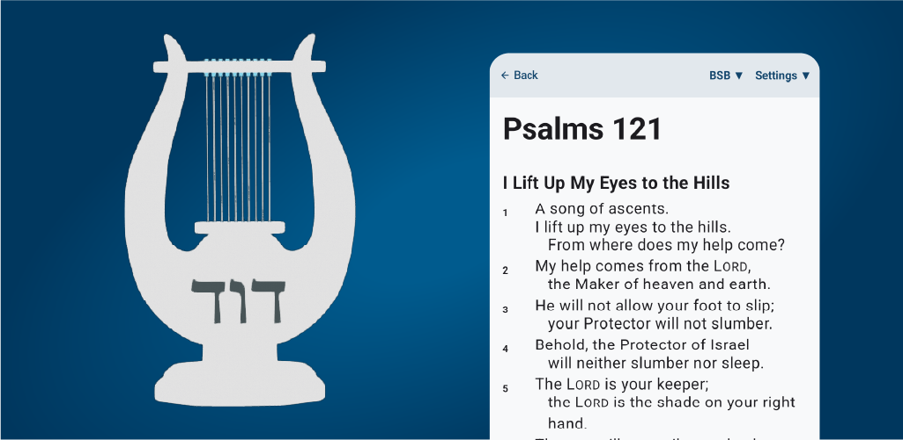
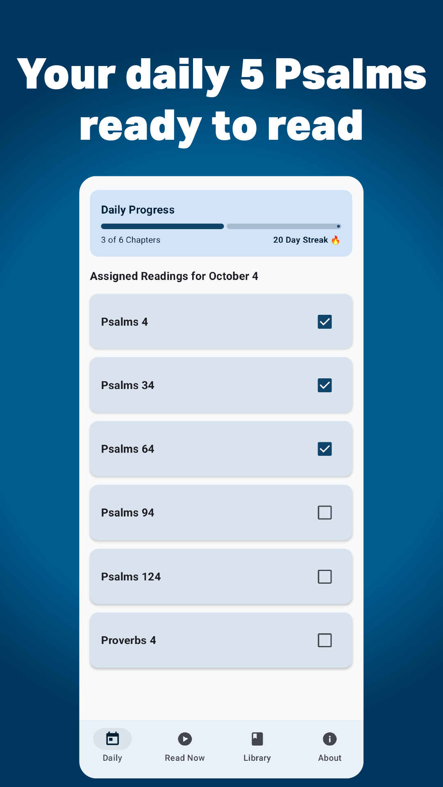
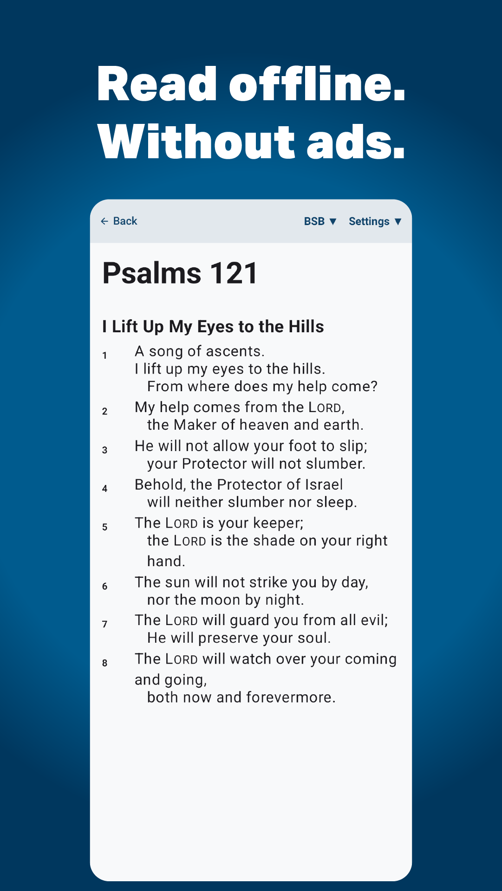
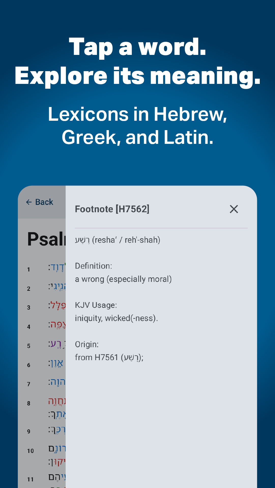
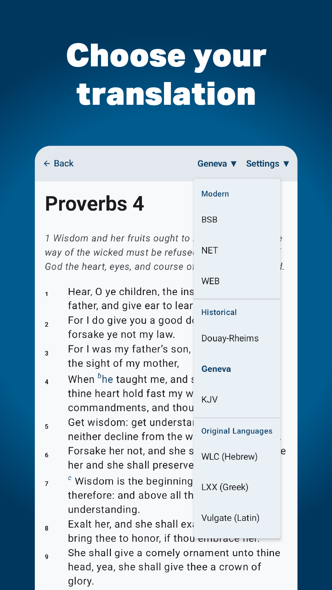
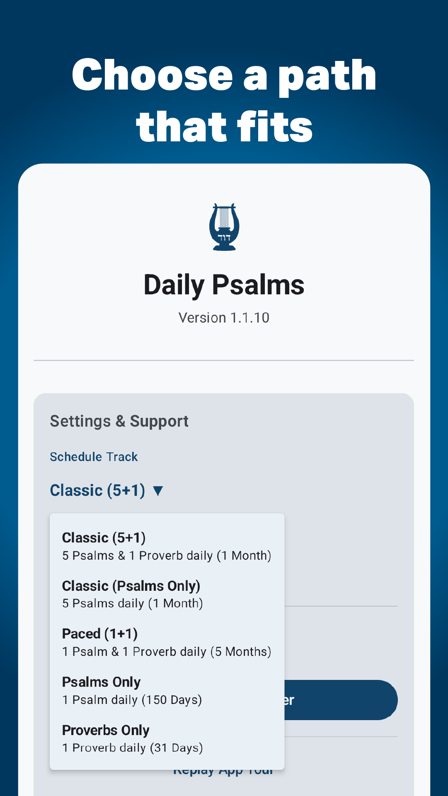
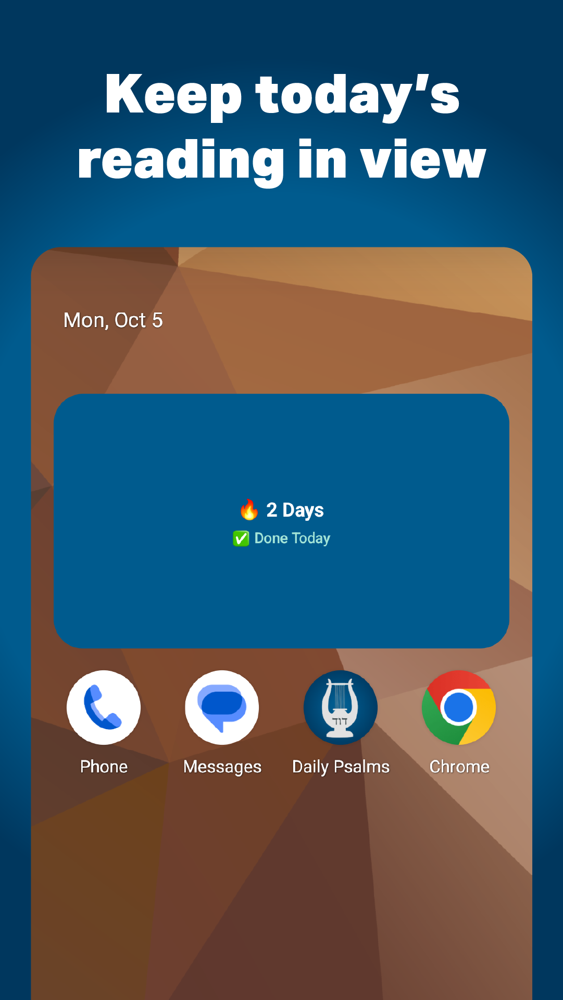

# Daily Psalms

Daily Psalms is a native, offline Android application designed to help users build a daily scripture reading habit. 

## The Backstory
This project started because of a lecture in my Sources of the Hebrew Bible class. My professor mentioned his habit of reading five Psalms and one Proverb every day, noting that it gave him a daily moment of personal worship and helped him grow wiser. 

I wanted to build that habit for myself, but standard Bible apps and physical books made it difficult. It was a pain to flip back and forth between chapters, and I had nothing to remind me to actually do it. I wanted a linear, distraction-free reading experience. 

I built this app to solve that problem. It calculates the daily chapters for you, tracks your streak, and provides deep study tools right inline. What started as a personal tool eventually grew into a public Play Store release.

## In the App

  

<table>
  <tr>
    <td align="center"></td>
    <td align="center"></td>
    <td align="center"></td>
  </tr>
  <tr>
    <td align="center">Daily reading plan</td>
    <td align="center">Distraction-free offline reading</td>
    <td align="center">Original-language study tools</td>
  </tr>
  <tr>
    <td align="center"></td>
    <td align="center"></td>
    <td align="center"></td>
  </tr>
  <tr>
    <td align="center">Multiple translations</td>
    <td align="center">Flexible reading schedules</td>
    <td align="center">Home screen widget</td>
  </tr>
</table>

## AI-Augmented Development
This was my very first app, and I could not have built it on my own. I used a heavily AI-augmented workflow. I directed the system logic and designed the UI, and I leveraged AI to write the syntax and walk me through the implementation step by step.

## Technical Overview
Building this required solving several data-wrangling and memory-management challenges, especially when dealing with public domain texts and ancient languages. 

### Data Processing & Native Development
To keep the app completely offline, I wrote custom Python scripts to process the text.
* Scraped and sanitized public domain texts (KJV, WEB, Septuagint, Latin Vulgate, Westminster Leningrad Codex, etc.).
* Transformed massive academic datasets into a unified JSON schema and standalone local lexicons.
* Built a declarative UI with Jetpack Compose, optimizing reader views with `LazyColumn` to prevent frame drops on chapters with thousands of interactive string links.
* Managed complex user state, alternative reading tracks, and habit streaks using Jetpack DataStore.
* Built an interactive Android Home Screen Widget to automatically sync reading progress.

## Core Features
* **Zero-Network Offline Model:** All 9 translations and full lexicons run entirely locally on the device with zero ads.
* **Study Tools:** Tap-to-define interlinear lexicons mapped to Strong's numbers for Hebrew (WLC) and Greek (LXX), plus a morphological Latin dictionary (Vulgate). It also includes a visual grammar color-coding guide.
* **Customizable Schedules:** Users can follow the standard Classic 1-month track (5 Psalms, 1 Proverb) or choose an alternative pace like the 5-month track. It also features a customizable weekly grace day system to seamlessly roll over missed chapters and protect streaks.

## Installation
The app is currently available on the Google Play Store. You can download it [here](https://play.google.com/store/apps/details?id=com.peter.dailypsalms):

---
*Designed and engineered by Peter Hill*
